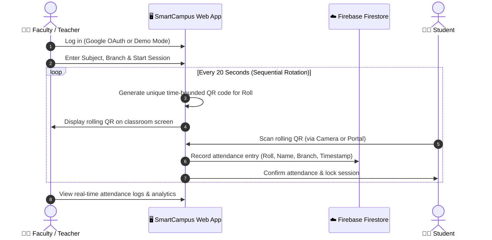

# 🎓 SmartCampus (DigiCampus) — Proxy-Free QR-Based Smart Attendance System

[](https://reactjs.org/)
[](https://redux-toolkit.js.org/)
[](https://ant.design/)
[](https://firebase.google.com/)
[](#-the-solution-dynamic-rolling-qr-architecture)
[](LICENSE)

> **Live Deployment:** [https://digiicampus.netlify.app/](https://digiicampus.netlify.app/)

---

## 📌 Problem Statement & Challenges

Despite rapid technological advancements, universities and colleges predominantly depend on **manual paper-based attendance sheets** or **static attendance registers**.

### Major Issues with Traditional Attendance:
1. **Pervasive Proxy Attendance:** Students routinely sign or call out roll numbers on behalf of absent peers.
2. **Heavy Time Consumption:** Physical roll calls consume 10–15 minutes out of a typical 60-minute lecture (loss of ~20% instructional time).
3. **Paper Wastage & Storage Burdens:** Thousands of physical sheets and registers require printing, manual archiving, and physical storage each semester.
4. **Data Loss & Discrepancies:** Paper records easily get damaged, lost, or misplaced, leading to grade reporting errors and administrative friction.
5. **Lack of Instant Analytics:** Faculties cannot quickly view attendance percentages, trends, or branch-wide reports in real time.

---

## 💡 The Solution: Dynamic Rolling QR Architecture

SmartCampus eliminates proxy attendance through a **time-limited cryptographic rotating QR code pipeline**.



### Why it is 100% Proxy-Free:
1. **Dynamic 20-Second Expiry:** Every QR code expires and rotates automatically after 20 seconds. An absent student cannot receive a screenshot via messaging apps and scan it in time.
2. **Student-Specific Token Binding:** Each QR code is uniquely tied to a specific student's roll number, name, branch, and session timestamp (`<RollNo> <Name> <Branch> <DD-MM-YYYY>`).
3. **Instant Single-Submission Lock:** Once a student marks attendance, their device session is verified and locked to prevent marking for others.
4. **Interactive Faculty Controls:** Faculties have instant Pause/Resume, Next Student, Previous Student, and time adjustment controls to accommodate classroom pacing.

---

## ✨ Features & Portals

### 1. 👨‍🏫 Faculty / Teacher Portal
- **Enrolled Student Management:** Register individual students with Roll No, Name, and Branch. Includes a **1-click batch loader** (`+ Load Sample Demo Batch`) to populate testing batches instantly.
- **Dynamic Attendance Session Generator:** Start interactive attendance sessions for any subject and branch. Includes countdown timer bars, clipboard copy for payload testing, and manual override navigation.
- **Real-Time Attendance Log & Analytics:** Parsed attendance log showing Roll No, Student Name, Branch, Session Date, Status Tag (`Present`), and Exact Timestamp. Features search, refresh, and clear tools.

### 2. 🧑‍🎓 Student Attendance Portal
- **Integrated Camera Scanner:** Uses live webcam/device camera stream (`react-qr-reader`) to scan classroom QR codes in real-time.
- **Manual Code Input Fallback:** Accommodates students on devices without webcams or restricted browser permissions by permitting manual QR string submission.
- **Quick Evaluation Simulator:** Test buttons (`Mark Student (Roll 1)`, `Mark Student (Roll 2)`, etc.) enabling 1-click test evaluations.
- **Instant Verification Display:** Immediate visual confirmation card displaying verified student identity and timestamp.

### 3. 🔐 Security & User Session
- **Firebase Google OAuth:** Authenticate securely using official Google accounts.
- **1-Click Demo Evaluation Login:** Built-in demo faculty account (`Faculty Demo Account`) allowing full offline/local evaluation without hitting Firebase OAuth domain restrictions.
- **Persistent Auth State:** Seamless session sync across page reloads using Firebase `onAuthStateChanged` and Redux Toolkit.

---

## 🛠️ Technology Stack

| Domain | Technology / Library | Purpose |
| :--- | :--- | :--- |
| **Frontend Framework** | **React 18** (`react`, `react-dom`) | Component-based interactive UI |
| **State Management** | **Redux Toolkit** (`@reduxjs/toolkit`, `react-redux`) | Centralized auth & session store |
| **UI Components** | **Ant Design v5** (`antd`, `@ant-design/icons`) | Modern enterprise layout, modals, tables, forms |
| **Styling** | **Vanilla SCSS** (`sass`) | Custom dark-mode color palette, responsive CSS grids |
| **Database & Auth** | **Firebase v9 Compat** (`firebase/auth`, `firebase/firestore`) | Cloud NoSQL database & Google authentication |
| **Routing** | **React Router v6** (`react-router-dom`) | Client-side declarative routing |
| **QR Code Engine** | **react-qr-code** & **react-qr-reader** | Dynamic SVG generation & live camera video parsing |
| **SEO & Meta** | **react-helmet** | Dynamic document title & metadata injection |

---

## 📂 Project Directory Structure

```text
SmartCampus/
├── .env                          # Development environment variables (BROWSER=none, PORT=3000)
├── .gitignore                    # Git ignore file for dependencies and build artifacts
├── .npmrc                        # NPM configuration (legacy-peer-deps=true for React 18)
├── package.json                  # Project manifest, dependencies, and npm scripts
├── package-lock.json             # Locked dependency tree
├── public/                       # Static public assets
│   ├── applogo.png               # DigiCampus brand logo
│   ├── favicon.ico               # Website favicon
│   ├── index.html                # Single-Page HTML root template
│   ├── manifest.json             # Web app manifest
│   └── images/                   # Landing page illustrations & feature cards
│       ├── banner.png
│       ├── card-image-1.png
│       ├── card-image-2.png
│       ├── card-image-3.png
│       └── card-image-4.png
├── src/                          # Application source code
│   ├── App.js                    # Root routing container and layout wrapper
│   ├── index.js                  # Application entry point with AntD ConfigProvider & Store
│   ├── global.scss               # Global styling system, typography, and CSS variables
│   ├── firebase.js               # Firebase client SDK initialization & Firestore references
│   ├── components/               # Shared reusable components
│   │   ├── Footer/
│   │   │   ├── Footer.js         # Site footer with platform links
│   │   │   └── Footer.module.scss
│   │   └── Menus/
│   │       ├── MenuTop.js        # Responsive navigation bar, Google & Demo Auth buttons
│   │       ├── MenuTop.module.scss
│   │       └── applogo.png
│   ├── pages/                    # Route-level pages
│   │   ├── home/                 # Landing home page
│   │   │   ├── index.js
│   │   │   ├── banner/           # Hero banner with CTA button
│   │   │   └── info-cards/       # Anti-proxy and feature benefit cards
│   │   └── attendance/           # Core Attendance application portal
│   │       ├── index.js          # Main tabbed container (Teacher & Student)
│   │       ├── index.module.scss
│   │       ├── Teacher.js        # Faculty management wrapper & auth guards
│   │       ├── AddStudent.js     # Student roster form, batch loader, registered table
│   │       ├── CreateAttendance.js # Dynamic rolling QR generator with interactive controls
│   │       ├── Student.js        # Camera scanner, manual input, evaluation simulator
│   │       └── ViewAttendance.js # Live attendance log table, parsed columns, stat counters
│   ├── redux/
│   │   └── redux.js              # Redux slice for authentication state
│   └── utils/
│       ├── constants.js          # Sample student batch seed data
│       └── menu.js               # Navigation menu items configuration
```

---

## 🚀 Quickstart & Setup Guide

### Prerequisites
- **Node.js**: v16.x, v18.x, v20.x, or v22+ installed ([Download Node.js](https://nodejs.org/))
- **npm**: v8.x or newer

### 1. Clone the Repository
```bash
git clone https://github.com/SAYALI8106/SmartCampus.git
cd SmartCampus
```

### 2. Install Dependencies
Because `react-qr-reader` has peer-dependency constraints with React 18, the project includes `.npmrc` configured with `legacy-peer-deps=true`. Simply run:
```bash
npm install
```

### 3. Start Development Server
```bash
npm start
```
The application will launch and compile at:
👉 **[http://localhost:3000](http://localhost:3000)**

### 4. Build for Production
To generate an optimized production bundle:
```bash
npm run build
```

---

## 🧪 Step-by-Step Testing & Verification Guide

Follow these simple steps to test the entire application end-to-end:

### Step 1: Login
- Open `http://localhost:3000` in your browser.
- In the top-right navigation bar, click **"Demo Login"** (or use **"Google Login"**).
- You will see the authenticated faculty session badge: `Faculty Demo Account`.

### Step 2: Open Teacher Portal
- Click **"Attendance"** in the top navigation or click **"Go to Attendance"** on the hero banner.
- Select the **"Teacher Portal"** tab.

### Step 3: Populate Students
- Under the **"Add Student"** menu, click **"+ Load Sample Demo Batch (5 Students)"**.
- The registered student table will immediately display all 5 enrolled demo students.

### Step 4: Create Dynamic Attendance Session
- Click the **"Create Attendance"** menu on the left sidebar.
- Enter Subject Name (e.g. `Distributed Systems`), Branch (`CSE`), Total Students (`5`).
- Click **"Start QR Attendance"**.
- A modal appears showing:
  - Dynamic QR Code for Student 1.
  - Active countdown progress bar (20 seconds).
  - Navigation controls: `< Previous`, `Pause / Resume`, `Next Student >`.
  - Click **"Copy QR Data"** to copy the payload to clipboard.

### Step 5: Mark Attendance (Student Portal)
- Switch to the **"Student Portal"** tab.
- Choose any method:
  1. Click **"Launch Camera Scanner"** to scan with your webcam.
  2. **OR** paste the copied payload into the text field and click **"Submit"**.
  3. **OR** click one of the quick simulator buttons (e.g. **"Mark Student (Roll 1)"**).
- An immediate verification card confirms: **"Attendance Recorded Successfully!"**.

### Step 6: View Live Attendance Log
- Switch back to the **"Teacher Portal"** -> **"View Attendance Records"**.
- See the real-time record with Roll No, Student Name, Branch tag, `Present` badge, session date, and exact timestamp.

---

## 🛡️ Recent Bug Fixes & Code Improvements

1. **Fixed React 18 Peer Dependency Conflict:** Configured `.npmrc` with `legacy-peer-deps=true` resolving `npm install` failures with `react-qr-reader`.
2. **Eliminated White Screen Crash on Unauthenticated Access:** Resolved `TypeError: Cannot read properties of null (reading 'email')` in `Teacher.js` by adding safe optional chaining and login prompts.
3. **Fixed JSX Rendering Glitches:** Removed a rogue colon `:` character in `MenuTop.js`.
4. **Resolved Horizontal Scrollbar Overflow on Windows:** Replaced `width: 100vw` with `width: 100%` across `MenuTop.module.scss` and `ViewAttendance.js`.
5. **Fixed Missing CSS Variable:** Defined `--sub-theme-color` in `src/global.scss` to resolve broken theme color inheritance.
6. **Corrected Ant Design Notification APIs:** Replaced deprecated `notification.open({ status: 'success' })` calls with official `notification.success(...)`, `notification.warning(...)`, and `notification.error(...)`.
7. **Added QR Modal Controls & Memory Leak Protection:** Added cleanup timers to `CreateAttendance.js` and included Next, Previous, and Pause controls.
8. **Parsed Attendance Log Columns:** Upgraded `ViewAttendance.js` from displaying raw unformatted strings to structured columns with analytics cards.

---

## 📄 License
This project is licensed under the MIT License - see the [LICENSE](LICENSE) file for details.